<p align="center">
  
</p>

<h1 align="center">secops-mcp</h1>

<p align="center"><b>Security alerts → reviewable Ansible remediation.</b> An MCP server that turns Wazuh, Sandfly and Checkmk alerts into gated, auditable fixes — with the guardrails in front of the action, not behind it. Runs as a persistent service on the homelab.</p>

<p align="center">
  
  
  
  
  
</p>

---

## What it does

It reads alerts from three security/monitoring systems and turns the ones that matter into **Ansible playbook runs** — but only after a triage step and a stack of safety gates. Reads are free; anything that changes state is dry-run by default, logged, and policy-checked.

## The safety model

Every remediation passes through, in order:

1. **Triage** — separate real exposure from stale-package noise (e.g. kernel vuln triage won't flag a CVE for a kernel the host isn't actually running).
2. **Policy gate** — [`config/policies.yaml`](config/policies.yaml) decides, per alert type/severity, whether a fix may run unattended or must wait for a human.
3. **Dry-run by default + explicit confirm** — `ansible_run_playbook` and every state-changing tool default to `dry_run: true`. Destructive tools (`host_isolate`, `credential_rotate`, …) require `confirm: CONFIRM_<TOOL_NAME>` — without it, the tool reports what it *would* do and takes no action.
4. **`PROTECTED_RESOURCES`** — a hard, **non-bypassable** block ([`permissions.py`](src/secops_mcp/permissions.py)) on any remediation touching SSH / network / firewall / sudo config, checked before every run regardless of dry-run or confirm tokens.
5. **Everything logged** — every tool call (dry-run or real) appends to `state/audit.jsonl`.

## The 21 tools

<p align="center">
  
</p>

| Group | Tools |
|---|---|
| **Wazuh** (read) | `wazuh_list_alerts` · `wazuh_list_vulnerabilities` · `wazuh_agent_status` |
| **Sandfly** (read) | `sandfly_list_findings` |
| **Checkmk** (read) | `checkmk_list_problems` · `checkmk_host_status` |
| **Triage** | `vuln_triage_kernel` |
| **Ansible** (remediate) | `ansible_list_playbooks` · `ansible_run_playbook` · `host_isolate` · `host_quarantine_lift` · `credential_rotate` · `service_restart` · `package_remediate` · `ansible_job_status` |
| **Incidents & audit** | `incident_open` · `incident_update` · `incident_close` · `audit_log_query` · `steer_status` |
| **Notify** | `slack_notify` |

## Philosophy: local is the compute plane

Modeled on [git-steer](https://github.com/ry-ops/git-steer)'s pattern — MCP tool interface, dry-run-by-default, explicit `CONFIRM_` strings, git-as-audit-log — but **inverted on where compute happens**. git-steer keeps a zero local footprint and offloads execution to GitHub Actions. A homelab has no equivalent free/ephemeral compute and already runs 24/7, so here **local *is* the runtime**: this service runs continuously on VM108, and Ansible (also on VM108) is what actually executes remediation.

Anything that needs to touch a VM or the network goes through an Ansible playbook (which can itself call the Proxmox/UniFi APIs) — so there's **one** consistent audit trail for destructive actions, rather than one split across ad-hoc MCP calls and playbook runs. (The existing `proxmox` and `unifi-network` MCP servers are deliberately *not* re-wrapped here.)

## Status

Deployed as a Portainer git-stack on VM108 (see [`docker-compose.yml`](docker-compose.yml)).

**Implemented and live-tested:**
- Wazuh client — manager API + indexer, real alerts and vulnerability-detector findings
- Sandfly and Checkmk clients — real findings / host & service status
- Policy engine including the non-bypassable `PROTECTED_RESOURCES` block
- Kernel-vulnerability triage — `package_remediate` won't remove a host's running kernel, and refuses rather than assuming safety when it can't verify kernel state

**Not yet implemented:**
- Real `ansible-runner` execution (`tools/ansible.py` is dry-run only)
- Actual playbook logic in `playbooks/*.yml` (TODO stubs)

[`runbooks/`](runbooks/) holds human-readable triage docs for recurring alert patterns — a lookup layer above the machine-executed `playbooks/`, until incidents can auto-match an incoming alert to one.

## Quick start

```bash
uv sync
uv run secops-mcp
```

Add to your Claude Desktop / Claude Code MCP config the same way as the `proxmox` and `unifi-network` servers. Configure sources in [`config/sources.yaml`](config/sources.yaml) and secrets via `.env` (see [`.env.example`](.env.example)).

<!-- org-footer -->
---

<p align="center"><sub>Part of <a href="https://github.com/ry-ops">ry-ops</a> · building the pipes between infrastructure, automation, and observability · built by <a href="https://github.com/ry-ops">ry-ops</a></sub></p>
